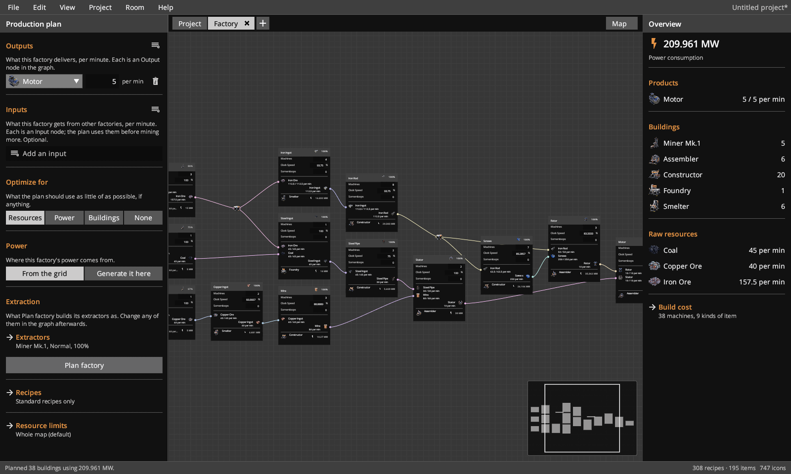
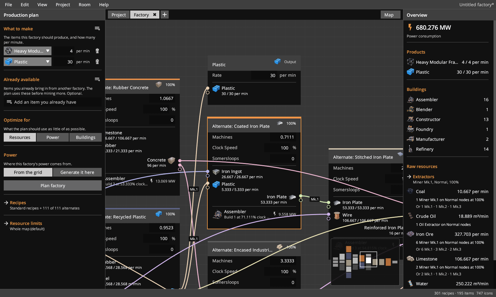
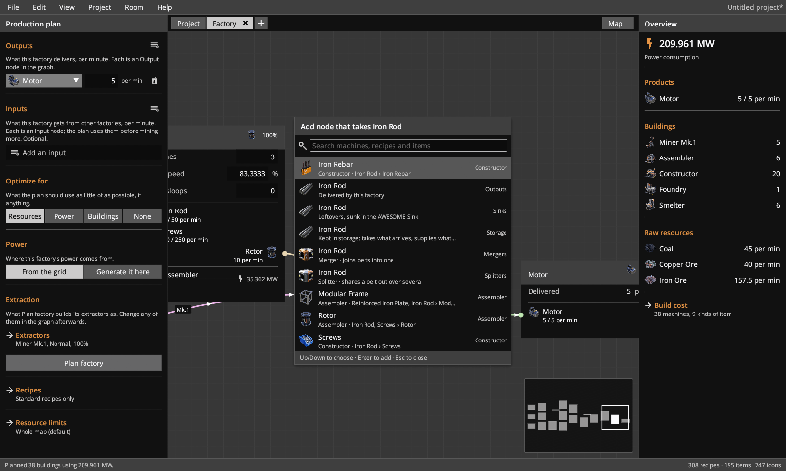
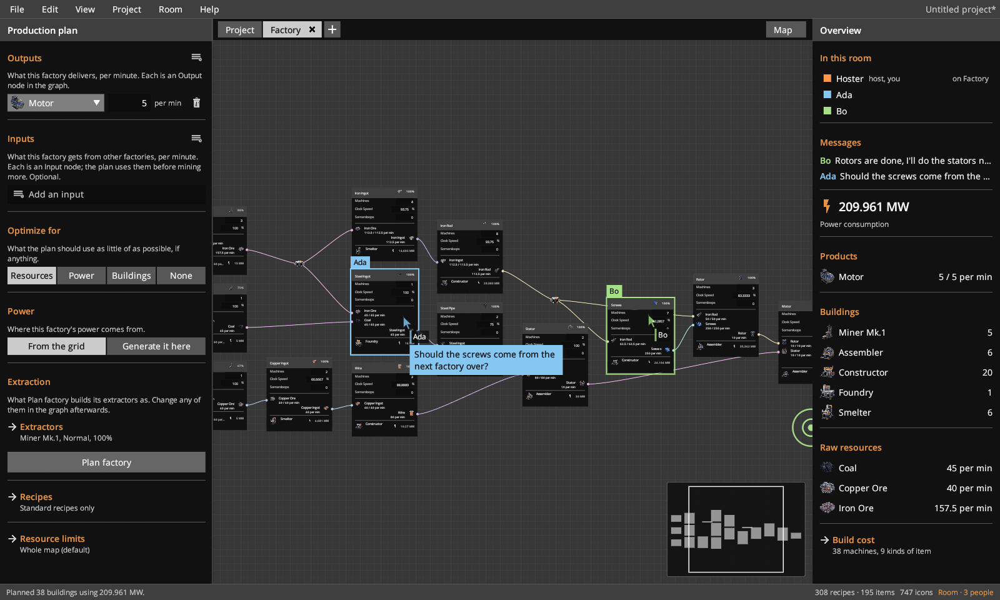
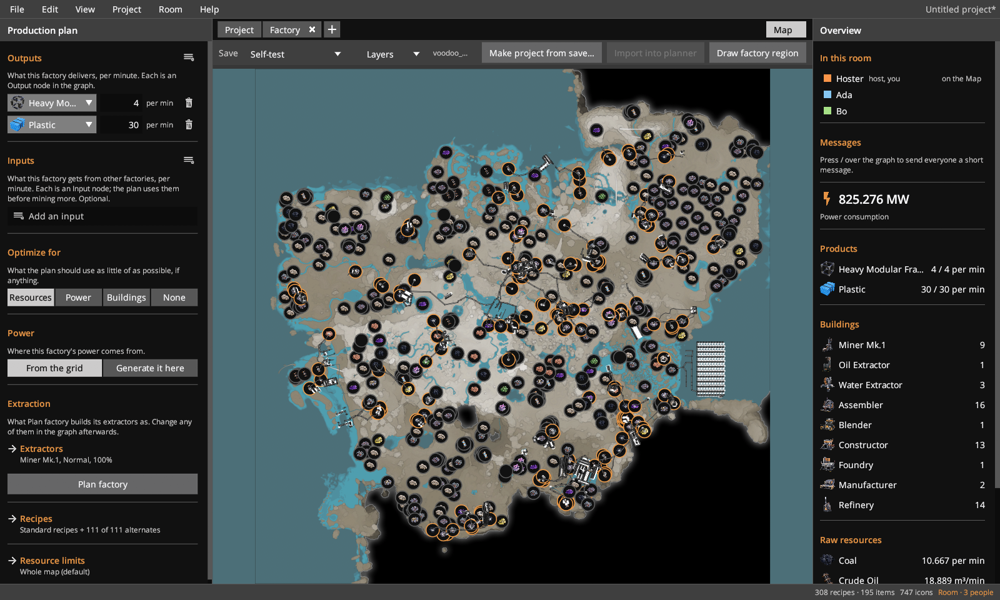
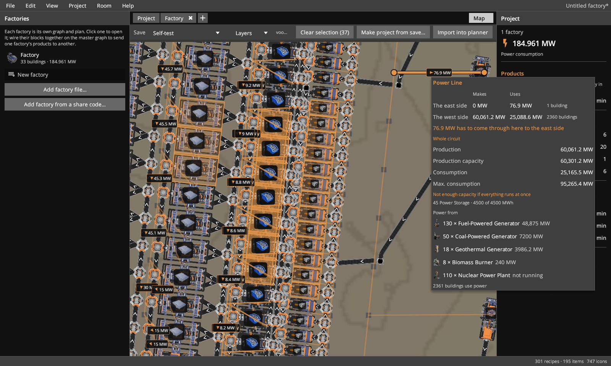
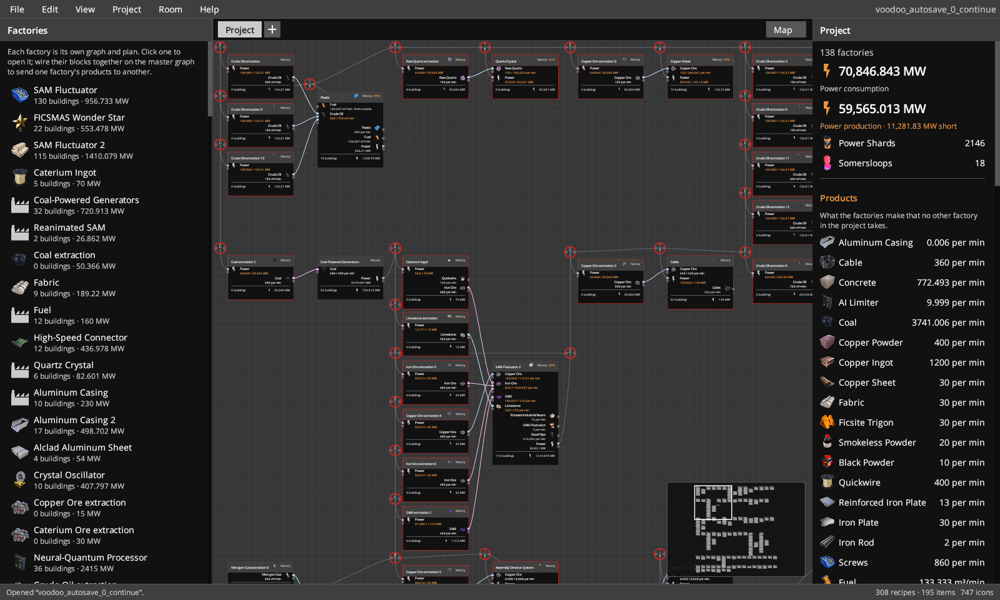

# Factory Builder

A Satisfactory production planner. Pick what you want to make, press **Plan factory**,
and edit the resulting node graph by hand. Rates, machine counts and power update as you go.

It reads recipes from your own install (`CommunityResources/Docs/en-US.json`) and uses the
game's own icons, font and colours, extracted locally. Nothing from the game is bundled.



## Download

Get `FactoryBuilder-<version>.zip` from the [latest release](https://github.com/phahx/FactoryBuilder/releases/latest)
(built from `main` on every push). Unzip it and run `Factory Builder.exe`; the first launch
installs it (see [First launch](#first-launch)). Windows only, and it needs Satisfactory
installed. The exe isn't code-signed, so Windows SmartScreen may warn the first time:
**More info › Run anyway**.

## Screenshots

Every node shows its machines, clock speed, Somersloops and what flows in and out:



Let go of a wire on empty canvas and Add node lists only what fits it:



Open a room and others plan with you live: everyone's cursor, what they have selected,
pings and short messages (see [Rooms](#rooms)):



The Map tab shows a save on the game map: resource nodes, every machine, belts and power.
Drag to select machines and import them into the planner as a factory:



Power lines show what flows through them. Hover one to see its circuit:



Make project from save turns every factory in a save into a project, linked by the belts
and pipes running between them:



## Build

Needs Rust with the `wasm32-unknown-unknown` target, a `wasm-bindgen-cli` that matches the
`wasm-bindgen` crate (build.ps1 tells you which), and the .NET SDK (to build the icon helper;
players don't need .NET).

```powershell
.\build.ps1            # development build: target\release\factory-builder.exe + tools\
.\build.ps1 -Package   # shipping build: target\package\Factory Builder\ and a .zip
```

Release builds map your user folder out of embedded source paths, so nothing built carries
your Windows account name.

## First launch

The app sets itself up the first time it runs:

1. **Install**: copies itself to `%LOCALAPPDATA%\Programs\Factory Builder` (or a folder you
   pick), adds Start menu and desktop shortcuts, an Apps & features entry with an uninstaller,
   and the `.fbfactory` double-click association, then restarts from there. No admin rights.
   A copy started from anywhere else hands off to the installed one.
2. **Game folder**: found from Steam's library list or the Epic launcher, and checked by
   reading its recipes.
3. **Icons and font**: the bundled helper (`tools\IconExtractor.exe` with `oodle_shim.dll`,
   an open-source decoder for the game's compressed files) extracts them in a few seconds.
4. **Your name** for rooms (optional).

Settings, the icon cache and the autosave live in `%APPDATA%\dev.factorybuilder.planner`;
uninstalling keeps them. When the game updates, the app offers to extract the icons again
(File › Settings › Extract again does it any time).

### Testing first launch (development builds)

File › Settings › Developer:

- **Test first launch** opens this build in a fresh test profile, as on a PC that has never
  run it. It installs as "Factory Builder (Test)" with its own folder, shortcuts and Apps &
  features entry, and doesn't take the `.fbfactory` association. Earlier test installs are
  removed first.
- **Run setup here** runs setup in the current window and profile.
- **Remove test install** uninstalls the test copy and deletes its profile.

Development builds never hand off to an installed copy (except in the test profile), so
installing doesn't get in the way of running your build.

## Files and sharing

Factories save as `.fbfactory` files (plain, versioned JSON; Export › Factory JSON writes the
same format). File › Copy share code puts a short `FB1-…` code on the clipboard that anyone
opens with File › Open share code. Import adds another factory beside the open one instead of
replacing it. Export › Image (PNG) renders the whole graph at full detail.

## Rooms

Room › Open a room lets others plan with you live: everyone edits the same factory and
sees each other's cursors. Your app is the server, on TCP port 47860 by default (change it in
File › Settings). There's one room code for everyone: it holds your local and public
addresses, and a guest's app uses whichever answers. Opening a room asks your router (UPnP)
to forward the port and for your public address; if the router can't say, the address comes
from api.ipify.org. The room dialog shows what worked and, if needed, which TCP port to
forward by hand.

In a room, Alt+click empty canvas to ping a spot, and press / to send everyone a short
message (it shows by your cursor and under In this room in the right-hand panel). Click
someone under In this room to follow their view; Esc, or panning, zooming or clicking
yourself, stops. Nodes someone else has selected get an outline and a name chip in their
colour.

## Live map (add-on)

Off until you turn it on in File › Settings › Add-ons. Then the Map tab shows players where the
save left them (saves don't keep names), and its Live map button sets up two optional sources:

- **A dedicated server.** The Map tab follows the newest save of the session it's running,
  through the game's own server API (`https://<server>:7777/api/v1`), and downloads a save only
  when there's a newer one. For its API token, open Server Manager in Satisfactory, pick the
  server, sign in as admin, and type `server.GenerateAPIToken` in its Console tab (the only
  place server commands run, rented servers included). The token is kept encrypted for your Windows account and only ever sent to that
  server. Its certificate is usually self-signed, so, as the game does, you confirm its
  fingerprint once; a different certificate is refused until you confirm it again.
- **The [Ficsit Remote Monitoring](https://ficsit.app/mod/FicsitRemoteMonitoring) mod**, on
  the game host. Players move live (about once a second, named), and every 15 seconds what's
  built now is laid over the save: new machines, belts and pipes appear, ones taken down go, and
  hovering a machine shows whether it's producing. On a dedicated server it's reached through
  the server's own port; otherwise start its web server with `/frm http start` in the game's
  chat (port 8080 by default).

## Layout

- `crates/fb-engine`: Docs parser, LP planner (good_lp/microlp), layout and flow simulation (petgraph)
- `crates/fb-ui`: the egui interface, compiled to wasm and shown in the Tauri window
- `crates/egui_node_graph2`: vendored node editor with local patches (see its PATCHES.md)
- `src-tauri`: the Tauri backend (`install.rs`: install/uninstall, `setup.rs`: game detection and extraction)
- `crates/oodle-shim`: Oodle-compatible decompressor DLL for the helper (on oozextract, MIT)
- `tools/IconExtractor`: the icon helper; pulls icons, font and UI images from the game's paks

## Licence

GPL-3.0 (see `LICENSE`). The vendored `crates/egui_node_graph2` keeps its MIT licence
(`crates/egui_node_graph2/LICENSE`).

Satisfactory is a trademark of Coffee Stain Studios. This is an unofficial fan tool, not
affiliated with or endorsed by Coffee Stain Studios.
